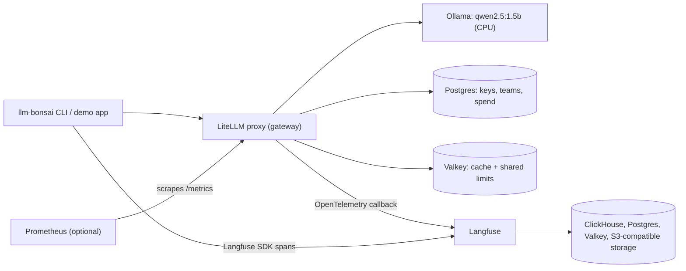

# llm-bonsai

[](https://github.com/cauabernardino/llm-bonsai/actions/workflows/check.yml)

> A real GenAI platform, deliberately kept tiny. Same structure, carefully pruned to fit small machines.

llm-bonsai runs the core of a GenAI platform in a local Kubernetes cluster, with **no paid API keys**:

- an **LLM gateway** ([LiteLLM](https://docs.litellm.ai/)): one OpenAI-compatible endpoint with per-team keys, budgets, rate limits, fallbacks and caching;
- a **self-hosted model** ([Ollama](https://ollama.com/) serving `qwen2.5:1.5b` on CPU), standing in for a GPU serving stack;
- **observability and evals** ([Langfuse](https://langfuse.com/)): traces, prompt versions, datasets and scored experiment runs;
- **metrics** (optional [Prometheus](https://prometheus.io/)): the gateway's requests, spend and latency over time;
- the **state** a gateway needs to scale out: Postgres for keys, teams and spend, and Valkey (an open-source Redis fork) for shared rate limits and the cache.

Each piece is the real thing (official images and charts, real config), shrunk to one replica, small models and tight limits. One typed Python CLI, `llm-bonsai`, builds the lab (`setup`) and pokes at it (`probe`). **It's a home lab for learning, not a production setup.**



| Component | Plays the role of | Namespace |
|---|---|---|
| LiteLLM proxy | The LLM gateway: single endpoint, per-team keys, budgets and limits, fallbacks, caching | `llm` |
| Ollama + a 1.5B model | Self-hosted model serving (vLLM/TGI on GPUs in production) | `llm` |
| Postgres, Valkey | The gateway's system of record, and its shared counters and cache | `llm` |
| Langfuse | Tracing, prompt management, datasets and evals | `observability` |
| Prometheus | Metrics scraping and queries | `observability` |

## Quick start

**Requirements.** `llm-bonsai setup preflight` checks every one of these and exits non-zero if one fails:

| | Needs |
|---|---|
| OS and CPU | macOS or Linux, arm64 or amd64 |
| Docker | running and usable without `sudo`, with **≥ 16.5 GiB of memory** and ≥ 6 CPUs. With Docker Desktop that's Settings → Resources → Memory ≥ 17 GB, and the host keeps whatever the VM doesn't take. |
| Disk | ≥ 40 GiB free where Docker keeps its data |
| Tools | `kubectl` ≥ 1.36, `helm` ≥ 3.8, `minikube` ≥ 1.39, plus [`uv`](https://docs.astral.sh/uv/) to install the CLI |

The cluster takes 14 GiB; see the [memory budget](#memory-budget). **Tested end to end on** macOS 26 on Apple Silicon (24 GB, Docker Desktop with Docker Engine 29.9, kubectl 1.37, helm 4.3, minikube 1.39). Preflight's Linux and WSL2 rules are covered by unit tests, but nobody has run the whole lab on Linux yet; reports are welcome.

Install the tools, then the CLI from a checkout:

```bash
brew install kubernetes-cli helm minikube uv   # macOS; on Linux use the links below
uv tool install .                              # puts `llm-bonsai` on your PATH
```

On Linux: [Docker Engine](https://docs.docker.com/engine/install/), [kubectl](https://kubernetes.io/docs/tasks/tools/install-kubectl-linux/), [helm](https://helm.sh/docs/intro/install/), [minikube](https://minikube.sigs.k8s.io/docs/start/) and [uv](https://docs.astral.sh/uv/getting-started/installation/). On macOS, use Homebrew's `kubectl`: the one Docker Desktop ships can be too old for the cluster.

Then build and check the lab:

```bash
llm-bonsai setup preflight   # read-only machine check, ends with a recommendation
llm-bonsai setup cluster     # its own minikube profile, llm-bonsai: 6 CPUs, 14 GB of RAM, 40 GB of disk
llm-bonsai setup all         # Ollama, Postgres, Valkey, Langfuse (+ prerequisites), LiteLLM; ~6 min the first time
llm-bonsai setup teams       # two teams with one virtual key each, saved to .env
llm-bonsai probe smoke       # end-to-end check: chat, streaming, embeddings, model access, traces
llm-bonsai ui                # browser access until Ctrl-C; see "Where to look" below
```

`probe smoke` checks the whole path with a team key and the stock OpenAI SDK:

```
PASS  chat completion (1.5s): 'Red.' via chat-small, 42 tokens
PASS  streaming (0.3s): 3 chunks → 'Red.'
PASS  embeddings (0.3s): 768-dim vector
PASS  forbidden model (chat-broken) (0.0s): rejected with HTTP 403
PASS  traced in Langfuse (6.5s): 2 generations for smoke-7e9ba901; chat-small: 42 tokens, 0.27s, $0.0045, team tag present
PASS  failed call traced in Langfuse (4.2s): ERROR generation: litellm.APIConnectionError: …
all smoke checks passed
```

To tear down: `llm-bonsai teardown` uninstalls the lab and its data but keeps the cluster; `llm-bonsai teardown --cluster` deletes the cluster. Both ask first.

Every step is idempotent and can run on its own (`llm-bonsai setup --help`). **The lab keeps to itself:** it runs in its own minikube profile and kube context, both named `llm-bonsai`, and every `kubectl`, `helm` and `minikube` call the CLI makes names them, so other clusters on your machine are never touched. `teardown` also refuses to empty a namespace it didn't create. `setup cluster` also makes `llm-bonsai` kubectl's current context, which the plain `kubectl` commands in this README assume. `LLM_BONSAI_CONTEXT` picks another context; a lab created by an earlier version runs in `minikube`, so use `export LLM_BONSAI_CONTEXT=minikube` for it. Secrets are random dev values in `.env`, generated once and never rotated; `.env.example` lists them, and [Lab home](#lab-home) says where the file lives.

**Working in the checkout?** Prefix commands with `uv run` (`uv run llm-bonsai probe smoke`), or use the Makefile shortcuts: `make up` (`setup all`), `make bootstrap` (`setup teams`), `make smoke`, `make ui`, `make down` (`teardown`), `make nuke` (`teardown --cluster`), and `make check` for lint, types and tests.

## Run it, check it, analyze it

Each probe opens its own port-forwards, so nothing else has to be running. Each one prints which key it uses and the prompt it sends, what happened with real numbers, and a **"What you just saw"** summary that states only what this run demonstrated. Prefix each command below with `llm-bonsai`.

| Command | What it proves | Takes |
|---|---|---|
| `probe smoke` | The gateway works end to end, and both successes and failures show up in Langfuse | ~20 s |
| `probe fallback` | A dead model group answers with HTTP 200 from its fallback; only the `x-litellm-*` headers and Langfuse show the failover | seconds |
| `probe limits` | A 3/min limit returns 429; a $0.05 budget lets the crossing request through, then returns 422 | ~1.5 min |
| `probe cache` | A cache hit is ~60× faster and costs $0; changing one parameter misses (exact-match key) | seconds |
| `probe replicas` | 2 gateway replicas without Valkey let 6 requests through a 3/min limit; with Valkey, 3 | ~2.5 min |
| `probe chaos` | Deleting the only gateway pod means a ~20 s outage, nearly all of it pod startup | ~2 min |
| `probe load` | Past `OLLAMA_NUM_PARALLEL=2`, throughput stays flat and time to first token climbs: requests queue | ~1.5 min |
| `probe app [--prompt strict] [--question "…"]` | One trace from the app down to the model: retrieval, the prompt version, the gateway's generation | seconds |
| `probe eval [--prompt strict] [--no-judge]` | The assistant scored over a dataset as one experiment run; run both prompts and compare | ~40 s |

### Where to look

`llm-bonsai ui` forwards these to your machine until Ctrl-C. The credentials are in `.env`.

| What | URL | Log in with |
|---|---|---|
| Langfuse | http://localhost:3000 | `LANGFUSE_INIT_USER_EMAIL` / `LANGFUSE_INIT_USER_PASSWORD` |
| LiteLLM admin UI and API | http://localhost:4000/ui, http://localhost:4000 | user `admin`, password `LITELLM_MASTER_KEY` |
| Prometheus (if installed) | http://localhost:9090 | no login |

Things worth opening:

- **Per-team spend:** LiteLLM UI → Teams. `payments-ai` and `support-bot` each have their own budget and spend.
- **One team's traffic:** Langfuse → Tracing, filtered by the tag `user_api_key_team_alias:support-bot`. The gateway sets that tag from the key, so clients can't fake it.
- **A fallback:** after `probe fallback`, Langfuse → Tracing, filtered by the user id it prints. You'll see an `ERROR` generation for the dead backend, then the successful one, ~20 ms apart.
- **App and gateway in one trace:** `probe app` prints a link. The app's spans and the gateway's generation share one trace through a single `traceparent` header.
- **Prompt versions:** Langfuse → Prompts → `support-answer`: v1 `baseline`/`production` and v2 `strict`, each with the generations that used it.
- **Experiment comparison:** run `probe eval` and then `probe eval --prompt strict`. The second prints a side-by-side link.
- **Metrics:** Prometheus → Status → Targets shows the gateway pods `UP`; paste the queries from [Metrics](#metrics) into Query.

### Chat with the model

```
$ llm-bonsai chat --system "You are a concise assistant."
Model     chat-small, through the gateway as support-bot
Session   http://localhost:3000/project/llm-bonsai/sessions/chat-b3a7bb48 (`llm-bonsai ui` first)
Commands  /reset, /exit, /help

you My name is Ana and I like bonsai trees. Reply in one sentence.
model Ana enjoys cultivating bonsai trees, a fascinating hobby that involves shaping miniature trees to artful forms.
4.7s · first token 2.15s · 21 tokens

you What is my name?
model Your name is Ana.
1.0s · first token 0.40s · 6 tokens
```

Replies stream token by token. The CLI keeps the history and sends it with every turn, because the gateway and the model are stateless: `/reset` (or `/clear`) drops it, and the model forgets. Ctrl-C stops a reply early; `/exit`, `/quit`, `exit` or Ctrl-D leaves. Anything starting with `/` is a command and never reaches the model. What you type while a reply streams isn't echoed into it; it shows up at the next prompt instead. Each turn is an ordinary request with the support-bot key, so it counts against the team's limits and budget, and the whole conversation is one **Langfuse session** (`metadata.session_id`). `--model` picks another model group.

### Talk to the gateway yourself

With `llm-bonsai ui` running in another terminal:

```bash
set -a; . ./.env; set +a     # load the keys (sourcing strips the quotes .env stores them with)

curl localhost:4000/v1/chat/completions \
  -H "Authorization: Bearer $LITELLM_KEY_SUPPORT_BOT" -H 'Content-Type: application/json' \
  -d '{"model":"chat-small","user":"alice","metadata":{"tags":["experiment-1"]},
       "messages":[{"role":"user","content":"Tell me a joke"}]}'

curl localhost:4000/v1/models -H "Authorization: Bearer $LITELLM_KEY_SUPPORT_BOT"     # what this key may use
curl localhost:4000/team/list -H "Authorization: Bearer $LITELLM_MASTER_KEY"          # spend per team
curl -u "$LANGFUSE_PUBLIC_KEY:$LANGFUSE_SECRET_KEY" \
  "localhost:3000/api/public/v2/observations?type=GENERATION&userId=alice&fields=core,basic,usage,model"
```

The OpenAI `user` field becomes the Langfuse user id, which is why the last query finds `alice`. From Python it's the plain OpenAI SDK, `OpenAI(base_url="http://localhost:4000/v1", api_key=<a team key>)`, with the gateway extras in `extra_body`: `user="alice", extra_body={"metadata": {"tags": ["experiment-1"]}}`, or `extra_body={"cache": {"use-cache": True}}` to opt into the cache.

### Metrics

The gateway serves Prometheus metrics on `/metrics`, and only an admin key may read them:

```bash
curl -sL -H "Authorization: Bearer $LITELLM_MASTER_KEY" localhost:4000/metrics | grep '^litellm_'
```

For the same metrics over time, install the optional Prometheus pod with `llm-bonsai setup prometheus`, then run `llm-bonsai ui` in another terminal:

| Question | PromQL |
|---|---|
| Requests per second, by team, model and status | `sum by (team_alias, requested_model, status_code) (rate(litellm_proxy_total_requests_metric_total{route="/v1/chat/completions"}[5m]))` |
| Spend per key in the last hour (fake prices) | `sum by (api_key_alias) (increase(litellm_spend_metric_total[1h]))` |
| Fallbacks, from which model group to which | `sum by (requested_model, fallback_model) (litellm_deployment_successful_fallbacks_total)` |
| p95 end-to-end latency per model group | `histogram_quantile(0.95, sum by (le, model_group) (rate(litellm_request_total_latency_metric_bucket[5m])))` |
| How many series the gateway exports | `count({job="litellm"})` |

`rate` and `increase` only see traffic inside their window, so run `llm-bonsai probe smoke` a couple of times first. Over an idle window the quantile is `NaN`.

---

## How it's built, phase by phase

The sections below explain what each phase installs, show results from real runs (abridged, as plain text), and list what’s worth knowing. Your timings will differ.

| Phase | What | Status |
|---|---|---|
| 0 | Preflight and local cluster | ✅ |
| 1 | Local model with Ollama | ✅ |
| 2 | LiteLLM gateway (Postgres, Valkey, teams, keys) | ✅ |
| 3 | Langfuse: tracing the gateway | ✅ |
| 4 | Gateway probes: fallback, limits, cache, replicas, chaos, load | ✅ |
| 4b | Tooling packaged as the `llm-bonsai` CLI | ✅ |
| 5 | App tracing with nested spans, prompt versions, a mini eval | ✅ |
| 6 | Gateway metrics and one Prometheus pod (optional) | ✅ |
| 7 | vLLM on CPU (optional) | planned |
| 8 | Argo CD (optional) | planned |
| — | Hosts beyond macOS (Linux first) | planned |

### Phase 0: Preflight and local cluster

`setup preflight` is read-only. It checks the host against the requirements above (OS, architecture, Docker's memory and CPUs, free disk where Docker stores data, tool versions) and prints a fix for each failure: Docker Desktop settings on macOS, `systemctl` and the `docker` group on Linux. It also reports the CPU, whether it has the bf16 instructions vLLM on CPU wants, and the current kube context. If [OrbStack](https://orbstack.dev/) is installed, it mentions that as a lighter alternative to Docker Desktop + minikube. `setup cluster` starts minikube on the Docker driver with Kubernetes 1.37 (pinned), 6 CPUs, 14 GB and 40 GB of disk, plus metrics-server for `kubectl top`.

- **The node lies about its size.** It reports everything Docker has (the VM's CPUs and memory on Docker Desktop, the host's on Linux) as its capacity, not minikube's real 6 CPU / 14 GiB cgroup. The scheduler overcommits without warning. Past 14 GiB, processes are OOM-killed inside the node instead of pods being evicted cleanly. Honest requests and limits, and watching `kubectl top`, are the only defence.
- **The CPU model matters later:** vLLM on CPU wants `bfloat16`. Apple M2 and newer have it, M1 doesn't; on x86 it takes AVX-512 BF16 or AMX.

### Phase 1: Local model with Ollama

The [otwld/ollama](https://github.com/otwld/ollama-helm) chart in `llm` pulls `qwen2.5:1.5b` (chat) and `nomic-embed-text` (embeddings) onto a 5 Gi volume, capped at 3 CPUs / 2.5 GiB. The models are pulled in a `postStart` hook, and readiness probes wait for it, so Ready means the models are on disk.

Clients normally go through the gateway. To reach Ollama directly, run `kubectl -n llm port-forward svc/ollama 11434:11434`, then `curl localhost:11434/api/tags`. Or skip the port-forward: `kubectl -n llm exec -it deploy/ollama -- ollama run qwen2.5:1.5b`.

- **CPU only.** The model runs inside the Linux VM, where Apple's Metal GPU isn't visible (`inference compute id=cpu`). Ollama sizes itself against the container's memory limit, not the node's.
- **`OLLAMA_NUM_PARALLEL=2`**, set explicitly. Two requests per model run at once; the rest queue. That's what `probe load` exposes.
- **`OLLAMA_KEEP_ALIVE=24h`** keeps the model loaded, so cold loads don't distort latency.
- **The context window defaults to 4096 tokens on CPU.** The KV cache grows with context × parallel requests: the model takes ~1.3 GiB loaded, and Ollama peaks at ~1.9 GiB serving two requests at once.

### Phase 2: LiteLLM gateway

Postgres (`postgres:16-alpine`) and Valkey come from plain manifests. LiteLLM uses the official chart in **monolith mode**: one pod for the API, the management API and the UI. The chart's default is three Deployments at 4 GiB each.

| Model name | Backed by | Purpose |
|---|---|---|
| `chat-small` | `qwen2.5:1.5b` | the working chat model, with **fake prices** so budgets can run out |
| `chat-broken` | a host that doesn't exist (5 s timeout, no retries) | falls back to `chat-small` |
| `embed` | `nomic-embed-text` | embeddings |

| Team (`setup teams`) | Allowed models | Limits |
|---|---|---|
| `payments-ai` | `chat-small`, `chat-broken` | 3 requests/min, $1000 budget |
| `support-bot` | `chat-small`, `embed` | 600 requests/min, $1000 budget |

The team keys are saved to `.env` as `LITELLM_KEY_PAYMENTS_AI` and `LITELLM_KEY_SUPPORT_BOT`. Re-running `setup teams` keeps valid keys and applies any limit changed in `TEAMS` (`src/llm_bonsai/catalog.py`). The budgets are generous on purpose; the probes that need to exhaust one create throwaway keys.

- **Spend lags by a few seconds:** it's written to Postgres in batches.
- **Local models cost $0**, so `chat-small` carries made-up per-token prices (~$0.005 per short chat). Otherwise no budget could ever be reached.
- **`drop_params: true`.** The OpenAI SDK sends `encoding_format=base64` on embeddings, and Ollama rejects it. Dropping unsupported params keeps the gateway transparent, at the cost of ignoring them silently.
- **The chart ships no database.** It passes `DATABASE_*` variables, and the image builds the URL. Migrations run as a pre-install hook Job, so Postgres must be up first; `setup all` installs them in that order.
- **Worth reading in the chart for production:** in-pod PgBouncer, a spend-accounting `collector` sidecar, the `/health/drain` preStop hook, and HPA on requests or tokens per second.

### Phase 3: Langfuse, tracing the gateway

Langfuse chart 2.x doesn't run ClickHouse itself. It creates `ClickHouseCluster`/`KeeperCluster` resources for the official ClickHouse operator, which needs cert-manager. Both are installed first, cluster-wide. Langfuse v4 then lands in `observability` with its stores, each sized down from production defaults:

| Store | Holds |
|---|---|
| ClickHouse (+ Keeper, required even for one replica) | traces, observations, scores |
| Postgres | users, projects, API keys, prompts, datasets |
| Valkey | job queues between `langfuse-web` and `langfuse-worker` |
| SeaweedFS | S3-compatible storage for raw events and media |

Headless init (`LANGFUSE_INIT_*`) creates the organisation, the project `llm-bonsai`, its API keys and an admin user from `.env`, so nobody has to click through the UI. LiteLLM exports every request, successes and failures, to Langfuse with the `langfuse_otel` callback.

- **The callback is `langfuse_otel`.** Langfuse v4 disables the legacy ingestion API that the classic `langfuse` callback uses, so that one silently logs nothing.
- **Team tags come from the gateway** (`langfuse_default_tags`). Clients can add tags but can't remove or fake the key and team ones, which is what makes per-team views trustworthy.
- **Failures are traced; authorization rejections aren't.** A 403 for a forbidden model never reaches the tracing callback. The gateway's logs and spend tables cover those.
- **v4 reads are observation-based.** `GET /api/public/traces` answers "not available in v4 events_only mode"; use `/api/public/v2/observations`. Its `tags` filter is silently ignored, which is why the probes find their traces by a unique user id.
- **Sizing:** ClickHouse gets `max_server_memory_usage` 1.5 GiB under a 2 GiB limit, so under pressure it fails a query instead of being OOM-killed. The stack idles at ~1.8 GiB.
- **Two Valkeys, two policies.** Langfuse's must not evict (`noeviction`: it holds job queues); the gateway's uses `allkeys-lru` (a cache and counters).
- **First boot restarts are normal.** `langfuse-web` and ClickHouse restart a few times while the operator and Keeper come up, then settle within 1–2 minutes.

### Phase 4: Gateway probes

This phase points LiteLLM's `redis.host` at Valkey, so rate limits and spend counters are shared across replicas. It also adds an **opt-in** response cache (`cache_params.mode: default_off`, enabled per request with `"cache": {"use-cache": true}`). A cache on by default would make the limit, budget and load probes measure the cache, and cached answers cost $0, so no budget could ever run out. The fallback, limits and replicas probes run on throwaway keys, so re-runs never use up the bootstrap keys.

#### Fallback

```
Requested model chat-broken → HTTP 200 in 5.95s
 x-litellm-model-group           chat-small
 x-litellm-attempted-fallbacks   1
Langfuse, user fallback-b617c376
  start      took   outcome   backend
  +0 ms     10 ms   ERROR     does-not-exist.llm.svc.cluster.local:1234 [Name or service not known]
 +30 ms   5835 ms   ok        ollama_chat/qwen2.5:1.5b
```

- The client sees a normal 200. Langfuse records the backend, not the alias, so the dead host is how you spot the failed deployment.
- This backend failed in 10 ms on DNS. A backend that *hangs* costs up to `timeout × (1 + num_retries)` before the fallback starts, hence `timeout: 5` and `num_retries: 0`.
- `mock_testing_fallbacks` is off in v1.111 unless an admin sets `general_settings.dangerously_allow_mock_testing_request_params: true`, so callers can't force failovers.

#### Limits and budgets

```
Part 1: rate limit, 10 requests in a row
  #1–#3  HTTP 200
  #4     HTTP 429  retry-after: 60
  → 3 of 10 allowed
Part 2: budget $0.05
  #1  HTTP 200  $0.0096 → $0.0522  ← crossed $0.05, still allowed
  #2  HTTP 422  Budget has been exceeded
Spend in Postgres (/v2/key/info) right now: $0.0096
```

- **429** for rate limits: back off and retry. **422** for budgets: retrying won't help until someone raises the budget.
- **Budgets are checked before a request and charged after it.** The crossing request succeeds, so cap `max_tokens` or leave headroom. Concurrent requests near the budget weren't tested.
- **Postgres lags.** The gateway enforces limits from its counters in Valkey; the UI and `/key/info` read the batched Postgres writes.

#### Cache

```
 #   request                      took   cache      cost
 1   opt in                    1654 ms   miss    $0.0091
 2   opt in, same as #1          19 ms   HIT     $0.0000
 3   opt in, temperature=0.1   1416 ms   miss    $0.0085
 4   no opt-in                 1495 ms   off     $0.0081
```

The cache key covers the model, the messages *and* the parameters, so this is exact-match caching. #4 didn't opt in, so the model ran again and wrote a different answer.

#### Replicas: why shared state matters

```
Scenario 1: 2 replicas, no Valkey → 6 × HTTP 200, 10 × HTTP 429
    pod d2jmp: 3 × 200 · pod n7bk7: 3 × 200
Scenario 2: 2 replicas, Valkey    → 3 × HTTP 200, 13 × HTTP 429
    pod q6c7d: 1 × 200 · pod z6q44: 2 × 200
```

Without shared state, each pod enforces its own limit, so the effective limit doubles. The burst comes from a pod inside the cluster, because `kubectl port-forward svc/…` pins one pod and would hide the load balancing. The probe redeploys the gateway three times and restores one replica at the end, even if a step fails (`--keep-replicas` leaves two).

#### Chaos: deleting the gateway pod

```
t= 15.1s  deleted pod litellm-6448bb6878-f2zmb
t= 36.0s  replacement pod Ready
Outage: 20.3s, nearly all of it waiting for the replacement pod
```

With one replica, a deleted pod means a full outage. In-flight streams may finish, because the server drains on SIGTERM, or get cut; the probe says which happened. New requests hang or fail. With 2+ replicas, new connections go to the survivor. In production, pair that with a PodDisruptionBudget and the `/health/drain` preStop hook.

#### Load: requests queue

```
 conc   reqs   req/s   p50 lat   p95 lat   p50 ttft   p95 ttft   errors
    1      5    0.24     4.20s     5.22s      0.11s      0.22s   0
    2      6    0.28     7.05s     7.97s      0.30s      0.40s   0
    4     10    0.31    12.18s    13.21s      5.98s      7.75s   0
    8     13    0.24    24.50s    36.07s     16.85s     23.74s   0
```

- **1 → 2:** time to first token stays low (two slots in Ollama), but the two requests share the CPU, so throughput rises only ~17%.
- **2 → 8:** throughput is flat while TTFT climbs. The extra requests are waiting in a queue, not computing.
- **So model serving scales on queue depth.** A CPU autoscaler sees the same busy CPU at 2 and at 8; vLLM exposes `num_requests_waiting` for exactly this.

Defaults: `--concurrency 1,2,4,8 --duration 20 --max-tokens 64 --model chat-small`. It's a closed-loop test (each worker waits for its answer), gentler than real traffic.

### Phase 5: App tracing and a mini eval

A tiny support assistant (`src/llm_bonsai/assistant.py`) answers in two steps: keyword retrieval over 8 hard-coded FAQ snippets, then one gateway call using the `support-answer` prompt from **Langfuse prompt management**. That prompt has two versions, `baseline` and `strict` ("one sentence, only from the context"), which the probes create, or update when the text in the code changes.

```
$ llm-bonsai probe app
Retrieved  refund-window, refund-time
Prompt     support-answer v1 (label baseline)
Answer     A refund can take 5 to 10 business days to reach the original payment method after it has been approved.

Langfuse trace dfcde0493699dd891ea1b58533e92156
  support-assistant (span) 2565 ms
     retrieval (retriever) 1 ms
     answer (generation; prompt support-answer v1) 2564 ms
        litellm_request (generation; chat-small, 94 tokens, $0.0119) 2517 ms
           raw_gen_ai_request (span) 2517 ms
```

- **The bottom two levels come from the gateway.** The app sends the `answer` span's W3C `traceparent` header, and LiteLLM's OpenTelemetry callback joins that trace instead of starting a new one.
- **Cost is counted once:** tokens and cost sit on the gateway's generation; the app's `answer` carries the prompt link but no usage.
- **`answer` links to the prompt version**, so latency, cost and scores break down by version.

```
$ llm-bonsai probe eval --prompt strict
 #   keyword   judge   question                                answer
 1   pass          5   How long do I have to ask for a refund? You have 30 days to request a refund.
 2   pass          5   When will my refund arrive?             Your refund will reach the original payment method within 5 to 10 business days…
 5   pass          5   How soon do you answer a chargeback?    We answer chargebacks within 7 days.
 ⋮   (8 of 8 pass the keyword check, all rated 5, with both prompts)
```

- **Each run is a Langfuse experiment** over the `support-faq` dataset (SDK v5 `run_experiment`; v4 dropped the old dataset-run API). Items are upserted with fixed ids, so both prompts run against the same dataset version. Run names carry a timestamp, because same-name runs would merge.
- **Keyword check:** deterministic, case-insensitive, whole words only. It only knows the words it was given.
- **The judge's score is only as good as its calibration.** Here every answer is right and every rating is 5, so this run can't tell a working judge from one that always says 5; the probe says exactly that. Checked separately on known pairs, `qwen2.5:1.5b` gave the reference answer 5 and a wrong one 3 in 7 of 8 pairs: it ranks correctly, but "3 = partly" in the rubric catches answers that are plain wrong. The previous `qwen2.5:0.5b` didn't judge at all: it rated everything 5 or echoed the rubric back. Unparseable replies are recorded as `judge-parsed = 0`, not as ratings. This is why a real judge is **calibrated against human labels** before anyone trusts it.
- **Retrieval is keyword overlap with crude suffix stripping**, so "chargeback" finds the "Chargebacks" snippet. Without it, that question retrieved nothing, and small models made up an answer. Real systems use embeddings for exactly this.

### Phase 6: Gateway metrics

The `prometheus` callback (next to `langfuse_otel` in `src/llm_bonsai/infra/litellm/values.yaml`) mounts `/metrics` on the gateway's own port. Nothing has to be licensed. After one smoke run, the gateway exports ~300 samples across ~75 metric names: requests, failures, tokens, spend and latency (including time to first token) per key, team and model group.

- **Admin keys only.** No key or a team key gets 401 (`require_auth_for_metrics_endpoint` defaults to `true`).
- **`/metrics` redirects (307) to `/metrics/`.** Plain `curl` without `-L` prints nothing.
- **Langfuse and Prometheus answer the same questions differently.** Langfuse keeps every request so you can drill into one; Prometheus keeps counters you can graph and alert on.
- **Cardinality grows per key and client:** labels include `hashed_api_key`, `client_ip` and `user_agent`. At real scale, trim them with `prometheus_exclude_labels`.

`setup prometheus` (optional; it needs the gateway running) adds one Prometheus pod (`src/llm_bonsai/infra/prometheus/prometheus.yaml`) that scrapes every 15 s and keeps a day of data in an `emptyDir`. It used ~36 MiB.

- **Prometheus has its own key.** A read-only admin user (`proxy_admin_viewer`) owns a key limited to `/metrics` (`allowed_routes`). It's saved as `LITELLM_KEY_PROMETHEUS` and mounted from a Secret. Measured: it scrapes, and gets 403 on chat and on the management API. A viewer key *without* the route limit could still call models and spend budget.
- **It scrapes each gateway pod** (`kubernetes_sd_configs`, through a Role that can only read pods in `llm`). Through the Service, each scrape would hit a different replica and the counters would jump. With 2 replicas, both showed `UP`.
- **Config changes apply without a restart** (`--config.auto-reload`). The ConfigMap is mounted as a directory, because a `subPath` mount never receives updates.
- **Every throwaway probe key leaves its own series** for the whole retention window: ~620 series after a few probes.
- Not shown: Grafana and alerting. In production that's the Prometheus Operator with a `ServiceMonitor` and recording rules.

---

## Lab home

The CLI ships its Helm values and manifests inside the package (`src/llm_bonsai/infra/`), so an installed `llm-bonsai` needs no checkout. Only `.env` lives outside it, in the **lab home**:

1. `$LLM_BONSAI_HOME`, if set;
2. else the checkout, when running from one with `uv run`;
3. else `~/.config/llm-bonsai/` (or `$XDG_CONFIG_HOME/llm-bonsai/`), which is where an installed CLI keeps it.

**A different lab home means a different `.env`.** New passwords for a running lab wouldn't match its databases, so `setup secrets` refuses to generate them while the lab's Secrets exist (`--force` overrides). To drive a lab you built with `uv run` from the installed CLI, run `export LLM_BONSAI_HOME=/path/to/llm-bonsai`.

## Repository layout

```
Makefile                  shortcuts for the CLI, plus `make check` (ruff, mypy --strict, pytest)
src/llm_bonsai/           the package behind the `llm-bonsai` command
  infra/                  what the CLI installs (Helm values, plain manifests); ships in the wheel
  cli.py                  root command: setup / probe / ui / teardown
  lab.py                  Lab: the clients one command uses, closed (with its port-forwards) when it ends
  config.py               lab home, .env (the only source of credentials), kube context, infra files
  catalog.py              namespaces, Services, model groups, teams
  models.py               shared records
  assistant.py            the demo support assistant
  chat.py                 `llm-bonsai chat`: a streamed conversation through the gateway
  report.py               output conventions every probe follows
  clients/                shell, Kube (pinned kubectl/helm), port-forward tunnels, Gateway, Langfuse
  setup/                  one module per `setup` concern: preflight, credentials, infra, teams, prometheus
  probe/                  one module per probe
tests/                    unit tests for the pure logic; no cluster needed
```

No Bitnami images or charts are used anywhere: Bitnami changed its free catalog in 2025, and old references break. Postgres and Valkey use the official images with plain manifests.

## Memory budget

Measured on this stack. Every container has requests and limits.

| Piece | RAM |
|---|---|
| LiteLLM (one pod) | ~1.2 GiB steady, ~1.8 GiB peak at startup |
| Ollama with `qwen2.5:1.5b` loaded | ~1.3 GiB idle, ~1.9 GiB serving 2 requests |
| Postgres + Valkey | ~120 MiB |
| Langfuse stack | ~1.8 GiB idle; ClickHouse grows with data, capped at 1.5 GiB |
| Kubernetes system pods | ~0.7 GiB |
| cert-manager + ClickHouse operator | ~100 MiB |
| Prometheus (optional) | ~36 MiB |

Prometheus is the only optional piece today, and `setup all` doesn't install it. The planned optional phases (vLLM, Argo CD) go first if memory gets tight.

## Troubleshooting

| Symptom | Cause | Fix |
|---|---|---|
| LiteLLM exits immediately with **code 132**, no logs | `Illegal instruction`: older Docker Desktop VMs on Apple Silicon advertise SVE2, which the chip lacks. Check with `docker run --rm python:3.13-slim python -c "import ctypes; print(bool(ctypes.CDLL(None).getauxval(26) & 2))"` (`True` = affected). | Update Docker Desktop, then `llm-bonsai teardown --cluster`, `setup cluster` and `setup all`. |
| The whole cluster stops; `docker inspect llm-bonsai` shows `OOMKilled=true` | The Docker VM barely exceeds minikube's limit, so the VM itself runs out. | Give Docker Desktop ≥ 17 GB. That restarts its VM and stops minikube, so then run `minikube start -p llm-bonsai`. |
| LiteLLM `OOMKilled` / `CrashLoopBackOff` | It needs ~1.8 GiB to start, though it settles at ~1.2 GiB. | Keep its limit ≥ 2.5 GiB. |
| After `teardown` + `setup all`, ClickHouse crash-loops with `Coordination error: Not authenticated` | Old data came back: minikube's provisioner only deletes volumes it created since its last restart, and a same-name claim reuses the old directory. | `teardown` now removes leftover volumes; run it again, then `setup all`. |
| `langfuse-web` crash-loops right after install: `lookup langfuse-clickhouse-headless ... no such host` | ClickHouse isn't up yet. | Wait 1–2 min; else `kubectl get clickhousecluster,keepercluster -n observability`. |
| Langfuse chart: `ClickHouse operator CRDs not found` | The operator and cert-manager must come first. | `setup cert-manager`, `setup clickhouse-operator`, then `setup langfuse`. |
| No traces in Langfuse | Wrong callback, host or keys. | `callbacks` must include `langfuse_otel`; check `LANGFUSE_OTEL_HOST` and that the `litellm-langfuse` Secret matches `.env`. |
| `GET /api/public/traces`: "not available ... v4 events_only mode" | Expected in Langfuse v4. | Use `/api/public/v2/observations`. |
| `helm upgrade`: `another operation ... is in progress` | An interrupted `helm` run left the release pending. | If it was the first install: `helm uninstall litellm -n llm`, then `setup litellm`. |
| `helm upgrade`: `conflict with "kubectl-set"` | Helm 4 uses server-side apply, and a field was edited by hand. | Undo the edit, or run the upgrade once with `--force-conflicts`. |
| Embeddings: 400 `encoding_format ... not supported by ollama` | The OpenAI SDK's default base64 encoding. | Keep `drop_params: true`, or send `encoding_format="float"`. |
| `could not port-forward svc/...` | The cluster is down, or the lab isn't installed. | `minikube start -p llm-bonsai`, or `llm-bonsai setup all`. |
| `no kube context 'llm-bonsai'` | The lab's cluster doesn't exist yet, or it was created by an earlier version in the `minikube` profile. | `llm-bonsai setup cluster`, or `export LLM_BONSAI_CONTEXT=minikube`. |
| `teardown`: `namespace … wasn't created by llm-bonsai` | `llm` or `observability` exists without the lab's label: someone else's, or created by an earlier version. | If it's the lab's, `llm-bonsai setup namespaces` labels it; otherwise leave it alone. |
| `setup secrets`: `… lacks N generated values, but the cluster already has …` | `.env` is new or incomplete (a different lab home, or the file was lost) while the lab's database passwords are still in the cluster. | Set `LLM_BONSAI_HOME` to the directory with the original `.env`. If it's gone, `llm-bonsai teardown` (which wipes the data) and then `setup all`. |
| A probe says `the gateway didn't answer` | The gateway pod is restarting or still starting. | `kubectl -n llm get pods` and the gateway's logs. |
| 2 gateway replicas left running after killing `probe replicas` | It restores on errors and a single Ctrl-C, not when killed outright. | `llm-bonsai setup litellm`. |
| `connection refused` on `localhost:3000`, `:4000` or `:9090` | Only `llm-bonsai ui` forwards those ports. | Run `llm-bonsai ui`. |
| `llm-bonsai ui`: `port ... already in use` | Usually a leftover `kubectl port-forward`. | `pkill -f 'port-forward svc/'`, then `llm-bonsai ui`. |
| `curl … /metrics` prints nothing | The 307 redirect to `/metrics/`. | Add `-L`, or use `/metrics/`. |
| 401 with `Received='sk-****…', expected to start with 'sk-'` | The key was read from `.env` with its quotes (e.g. via `cut`). | `. ./.env` instead. |
| `probe app` / `probe eval`: `NotFoundError` from Langfuse | Langfuse was reset while a run started. | Re-run; the probes recreate the prompt and dataset. |
| `kubectl top` shows tiny or stale numbers | metrics-server lags up to a minute. | Wait and retry. |
| Odd `kubectl` errors | The client is more than one minor version from the server. | `brew install kubernetes-cli`; check `which kubectl`. |

## Security notes

All credentials are random, dev-only values in a gitignored `.env`. Nothing listens beyond `localhost`: access goes only through `kubectl port-forward`, opened per command. The gateway's Valkey runs without auth inside the cluster. No real provider keys are needed or used; a cloud model would only ever appear as a commented-out entry in `src/llm_bonsai/infra/litellm/values.yaml`, reading its key from the environment.

## License

[Apache License 2.0](LICENSE). Use, change and share it as you like, including commercially. If you redistribute it or something built on it, keep the [NOTICE](NOTICE) file with it, which credits the original project, and mark the files you changed.

## Pinned versions

| Component | Version |
|---|---|
| Kubernetes (minikube 1.39) | 1.37.0 |
| Ollama chart / image | 1.96.0 / 0.40.17 |
| LiteLLM chart / image | 1.111.0 / v1.111.0 |
| Postgres | 16.16-alpine |
| Valkey | 9.2.1-alpine |
| cert-manager chart | v1.21.3 |
| ClickHouse operator chart | 0.0.8 |
| Langfuse chart / app | 2.3.0 / 4.83.0 |
| ClickHouse / Keeper | 26.8.36.3 |
| Langfuse Python SDK | 5.2.0 |
| Prometheus (optional) | v3.16.0 |
