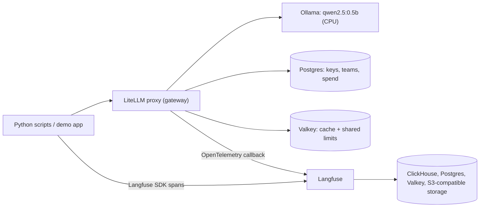

# llm-bonsai

> A real GenAI platform, deliberately kept tiny. Same structure, carefully pruned to fit a laptop.

llm-bonsai is a hands-on lab that runs the core building blocks of a production GenAI platform on a single Mac, inside a local Kubernetes cluster, for free:

- an **LLM gateway** ([LiteLLM](https://docs.litellm.ai/)): one OpenAI-compatible endpoint with virtual keys per team, budgets, rate limits, fallbacks and caching;
- a **self-hosted model** ([Ollama](https://ollama.com/) running `qwen2.5:0.5b` on CPU), standing in for a GPU serving stack;
- **LLM observability and evals** ([Langfuse](https://langfuse.com/)): traces, prompt versions, datasets and scored experiment runs;
- the **state** a gateway needs to scale out: Postgres for keys/teams/spend, Valkey (an open-source Redis fork) for shared rate limits and caching.

Everything runs locally, so you need **no paid API keys**. Infrastructure is Helm charts and plain YAML. Automation and demos are small Python scripts run with [`uv`](https://docs.astral.sh/uv/).

**This is a home-lab for study purposes, not a production setup.** Each piece is the real thing (official images and charts, real config), only sized down: one replica, small models, tight memory limits. Building it phase by phase shows you how the pieces depend on each other and where they break.

## Architecture



Two namespaces: `llm` (Ollama, LiteLLM, Postgres, Valkey) and `observability` (Langfuse).

| Component | Plays the role of |
|---|---|
| LiteLLM proxy | The LLM gateway: single endpoint, per-team keys, budgets/limits, fallbacks, caching |
| Ollama + a 0.5B model | A cheap stand-in for self-hosted model serving (vLLM/TGI on GPUs in production) |
| Langfuse | Tracing, prompt management, datasets and evals |
| Postgres | The gateway's system of record: keys, teams, budgets, spend logs |
| Valkey | Shared state across gateway replicas: rate-limit counters and the response cache |

## Status

| Phase | What | Status |
|---|---|---|
| 0 | Preflight and local cluster | ✅ |
| 1 | Local model with Ollama | ✅ |
| 2 | LiteLLM gateway (Postgres, Valkey, teams, keys) | ✅ |
| 3 | Langfuse: tracing the gateway | ✅ |
| 4 | Gateway demos: fallback, limits, cache, replicas, chaos, load test | ✅ |
| 5 | App tracing with nested spans, prompt versions, a mini eval | planned |
| 6 | Prometheus metrics (optional) | planned |
| 7 | vLLM on CPU (optional) | planned |
| 8 | Argo CD (optional) | planned |

## Requirements

- **Apple Silicon Mac with 24 GB of RAM or more.** The cluster takes 14 GB. The stack was sized for that budget; with less RAM you'll have to trim it.
- **~40 GB of free disk.**
- **Docker Desktop, recent version**, with **Memory set to ≥ 17 GB** (Settings → Resources). The extra ~3 GB above the cluster's 14 GB is for the Docker VM itself; see [Troubleshooting](#troubleshooting).
- [Homebrew](https://brew.sh/), plus `kubectl`, `helm`, `minikube` and `uv`:

  ```bash
  brew install kubernetes-cli helm minikube uv
  ```

  Docker Desktop ships its own `kubectl`, which can be too old for a current cluster (kubectl supports ±1 minor version of the server). Homebrew's `kubectl` takes precedence on Apple Silicon.

> [OrbStack](https://orbstack.dev/) with its built-in Kubernetes is a lighter alternative to Docker Desktop + minikube. This guide uses minikube; `make preflight` recommends OrbStack if it finds it installed.

### Memory budget

Rough sizes measured on this stack:

| Piece | RAM |
|---|---|
| LiteLLM (single pod) | ~1.2 GiB steady, ~1.8 GiB peak at startup |
| Ollama with `qwen2.5:0.5b` loaded | ~1 GiB |
| Postgres + Valkey | ~120 MiB |
| Kubernetes system pods | ~0.7 GiB |
| Langfuse stack (web, worker, ClickHouse, Keeper, Postgres, Valkey, SeaweedFS) | ~1.8 GiB idle; ClickHouse grows with data, capped at 1.5 GiB |
| cert-manager + ClickHouse operator | ~100 MiB |

Every container has CPU/memory requests and limits. If memory gets tight, drop optional pieces in this order: Argo CD → vLLM → Prometheus → the second LiteLLM replica.

## Quick start

```bash
make preflight      # check the machine; read the recommendation at the end
make cluster        # minikube: 6 CPUs, 14 GB, metrics-server
make up             # everything: Ollama, Postgres, Valkey, Langfuse (+ prerequisites), LiteLLM
                    # ~6 min the first time, mostly image pulls

# in a second terminal, keep this running:
make pf             # localhost:4000 → LiteLLM, localhost:3000 → Langfuse (restart themselves if they drop)
                    # stop them with `make pf-stop` (or Ctrl-C in that terminal)

make bootstrap      # create teams and their virtual keys, saved to .env
make smoke          # end-to-end check through the gateway
```

Tear down:

```bash
make down           # uninstall the stack, including volumes (keeps cert-manager and the ClickHouse operator)
make nuke           # delete the whole minikube cluster
```

Secrets live in `.env` (gitignored). `make secrets` (run by `make up`) generates random dev-only values the first time and never rotates them afterwards. See `.env.example` for the variables.

## Repository layout

```
Makefile              entry point for everything
infra/
  namespaces.yaml
  ollama/values.yaml      Helm values for the Ollama chart
  postgres/postgres.yaml  StatefulSet + Service (official postgres image)
  valkey/valkey.yaml      Deployment + Service (official valkey image)
  litellm/values.yaml     Helm values for the LiteLLM chart, including the model config
  cert-manager/values.yaml
  langfuse/values.yaml    Helm values for the Langfuse chart, sized for a laptop
scripts/
  preflight.py            machine checks and cluster recommendation
  gen_secrets.py          random dev secrets into .env
  wait_ready.py           wait for every Deployment/StatefulSet in a namespace
  bootstrap_gateway.py    teams + virtual keys
  smoke_test.py           end-to-end gateway check, including traces in Langfuse
  lab.py                  shared helpers for the demos (clients, throwaway keys, Langfuse polling)
  demo_fallback.py demo_limits.py demo_cache.py demo_replicas.py demo_chaos.py
  load_test.py            asyncio load generator: latency, TTFT, error rate per concurrency
```

No Bitnami images or charts are used anywhere: Bitnami changed its free image catalog in 2025, and old references break. Postgres and Valkey use the official images with plain manifests.

---

## Phase 0: Preflight and local cluster

**What it does.** `make preflight` is read-only. It reports RAM, CPU model, free disk, the Docker VM's size, which tools are installed and which kube contexts exist, and then recommends how to create the cluster. The CPU model matters later: vLLM on CPU wants `bfloat16`, which M2 and newer chips support and M1 doesn't.

`make cluster` creates a minikube cluster on the Docker driver with 6 CPUs and 14 GB, and enables metrics-server so `kubectl top` works.

**What to expect at the end.**

```bash
$ kubectl get nodes
NAME       STATUS   ROLES           AGE   VERSION
minikube   Ready    control-plane   1m    v1.37.0

$ kubectl top node
NAME       CPU(cores)   CPU(%)   MEMORY(bytes)   MEMORY(%)
minikube   145m         1%       668Mi           4%
```

**Worth knowing.** The node advertises the **Docker VM's** CPUs and memory as its capacity, not minikube's real limits (`docker inspect minikube` shows the actual 6 CPU / 14 GiB cgroup). The scheduler therefore thinks it has more room than exists. Pods can be overcommitted without any warning, and if their combined usage passes 14 GiB, processes get OOM-killed inside the node container instead of Kubernetes evicting pods cleanly. That's why honest requests/limits and watching `kubectl top` matter here.

## Phase 1: Local model with Ollama

**What it does.** Installs the [otwld/ollama](https://github.com/otwld/ollama-helm) chart into `llm`, pulls `qwen2.5:0.5b` (chat) and `nomic-embed-text` (embeddings) onto a 5 Gi volume, and caps the pod at 3 CPUs / 2 GiB.

**What to expect at the end.** The `ollama` pod is Ready. The chart pulls models in a `postStart` hook, and Kubernetes doesn't run readiness probes until `postStart` has finished, so Ready already means the models are on disk.

**Try it.** In normal use, clients go through the gateway (Phase 2). To talk to Ollama directly, open a port-forward in its own terminal:

```bash
kubectl -n llm port-forward svc/ollama 11434:11434
```

then:

```bash
curl localhost:11434/api/tags                       # lists both models
curl localhost:11434/v1/chat/completions -H 'Content-Type: application/json' \
  -d '{"model":"qwen2.5:0.5b","messages":[{"role":"user","content":"Why is the sky blue?"}]}'
curl localhost:11434/api/embed -d '{"model":"nomic-embed-text","input":"hello"}'
curl localhost:11434/api/ps                         # what's loaded, and how big
```

Other ways in:

- your local `ollama` CLI: `OLLAMA_HOST=localhost:11434 ollama run qwen2.5:0.5b` (stop any local Ollama app first, since it also wants port 11434);
- no port-forward at all: `kubectl -n llm exec -it deploy/ollama -- ollama run qwen2.5:0.5b`.

**Worth knowing.**

- **It runs on CPU only.** The model runs inside the Linux VM, where Apple's Metal GPU isn't visible. The logs show `inference compute id=cpu library=cpu`. Ollama sizes itself against the container's memory limit, not the node's.
- **`OLLAMA_NUM_PARALLEL=2`** is set explicitly (the default is "backend decides"). Up to 2 requests per model run at once; the rest **queue**. The Phase 4 load test makes this visible: latency jumps once concurrency exceeds 2. That's why serving is scaled on queue depth, not CPU.
- **`OLLAMA_KEEP_ALIVE=24h`** (default 5 minutes) keeps the model loaded between experiments, so cold loads don't distort latency measurements.
- **The context window defaults to 4096 tokens on CPU.** The KV cache grows with `context × parallel requests`; with the model loaded, Ollama reports ~690 MiB.

## Phase 2: LiteLLM gateway

**What it does.**

1. **Postgres** (`postgres:16-alpine`, 1 Gi volume) and **Valkey** (`valkey/valkey`, in-memory only).
2. **LiteLLM** from the official chart in **monolith mode**: one pod serving the OpenAI-compatible API, the management API and the admin UI. The chart's default splits these into three Deployments at 4 GiB each, which doesn't fit a laptop.
3. Three model names behind the gateway:

   | Model name | Backed by | Purpose |
   |---|---|---|
   | `chat-small` | `qwen2.5:0.5b` on Ollama | the working chat model, with **fake prices** so budgets can actually run out |
   | `chat-broken` | an address that doesn't exist (5 s timeout, no retries) | falls back to `chat-small`, for the fallback demo |
   | `embed` | `nomic-embed-text` on Ollama | embeddings |

4. **`make bootstrap`** creates two teams, each with one virtual key:

   | Team | Allowed models | Limits |
   |---|---|---|
   | `payments-ai` | `chat-small`, `chat-broken` | 3 requests/min, $1000 budget |
   | `support-bot` | `chat-small`, `embed` | 600 requests/min, $1000 budget |

   The keys are written to `.env` as `LITELLM_KEY_PAYMENTS_AI` and `LITELLM_KEY_SUPPORT_BOT`. It's safe to re-run: existing teams are reused, and valid keys are kept with their limits updated to match the script, so changing a limit there and re-running `make bootstrap` applies it.

   The budgets are generous on purpose. Load and chaos runs spend a few fake dollars each, and the Phase 4 demos that need to *run out* of budget create throwaway keys with a tiny one.

**What to expect at the end.**

```
$ make smoke
PASS  chat completion (0.3s): 'Red.' via chat-small, 42 tokens
PASS  streaming (0.3s): 3 chunks → 'Red.'
PASS  embeddings (0.6s): 768-dim vector
PASS  forbidden model (chat-broken) (0.0s): rejected with HTTP 403
all smoke checks passed
```

The smoke test uses the `support-bot` key and the stock OpenAI Python SDK. Pointing the SDK's `base_url` at the gateway is all a client needs to change.

**Try it.** With `make pf` running:

```bash
set -a; source .env; set +a        # load the keys into your shell

# chat as the support-bot team
curl localhost:4000/v1/chat/completions \
  -H "Authorization: Bearer $LITELLM_KEY_SUPPORT_BOT" -H 'Content-Type: application/json' \
  -d '{"model":"chat-small","messages":[{"role":"user","content":"Tell me a joke"}]}'

# which models can this key use?
curl localhost:4000/v1/models -H "Authorization: Bearer $LITELLM_KEY_SUPPORT_BOT"

# spend per key and per team (admin calls use the master key)
curl "localhost:4000/key/info?key=$LITELLM_KEY_SUPPORT_BOT" -H "Authorization: Bearer $LITELLM_MASTER_KEY"
curl localhost:4000/team/list -H "Authorization: Bearer $LITELLM_MASTER_KEY"
```

From Python, it's the plain OpenAI SDK:

```python
from openai import OpenAI

client = OpenAI(base_url="http://localhost:4000/v1", api_key="<a team key from .env>")
print(client.chat.completions.create(
    model="chat-small", messages=[{"role": "user", "content": "Hi!"}]
).choices[0].message.content)
```

**Admin UI:** http://localhost:4000/ui. Log in with user `admin` and the value of `LITELLM_MASTER_KEY` as the password. It shows teams, keys, spend and request logs.

**Worth knowing.**

- **Spend lags by a few seconds.** LiteLLM writes spend to Postgres in batches, not on every request.
- **Local models cost $0**, so `chat-small` carries made-up `input_cost_per_token`/`output_cost_per_token` values. Without them, no budget could ever be reached. One short chat costs ~$0.005; `make demo-limits` (Phase 4) shows what happens when a key reaches its budget.
- **`drop_params: true`.** The OpenAI SDK sends `encoding_format=base64` on embeddings by default, and the Ollama provider rejects it with a 400. Dropping params a provider doesn't support keeps the gateway transparent to clients. The trade-off is that unsupported parameters are now ignored silently.
- **The chart doesn't ship a database**, and it never builds `DATABASE_URL` itself. It passes `DATABASE_HOST/PORT/USER/NAME/PASSWORD` and the image assembles (and URL-encodes) the URL. Database migrations run as a Helm **pre-install hook Job**, so Postgres must be up before LiteLLM is installed; `make up` does it in that order.
- Settings in the chart worth reading for production: an in-pod PgBouncer (`database.connectionPool`), a `collector` sidecar that moves spend accounting off the request path, a `/health/drain` preStop hook for graceful shutdowns, and HPA on requests/tokens per second through Prometheus Adapter.

## Phase 3: Langfuse, tracing the gateway

**What it does.**

1. Installs two cluster-wide prerequisites: **cert-manager**, and the official **ClickHouse operator**. Langfuse chart 2.x doesn't run ClickHouse itself; it creates `ClickHouseCluster` and `KeeperCluster` resources, and the operator turns them into pods. The operator gets its webhook certificates from cert-manager.
2. Installs **Langfuse v4** into `observability` with all its stores, each sized down from production defaults:

   | Store | What Langfuse uses it for |
   |---|---|
   | ClickHouse (+ Keeper) | traces, observations and scores: the analytical data. Keeper coordinates ClickHouse; it's required even for one replica. |
   | Postgres | users, projects, API keys, prompts, datasets: the transactional data |
   | Valkey | job queues between `langfuse-web` (API/UI) and `langfuse-worker` (ingestion) |
   | SeaweedFS | S3-compatible blob storage for raw event payloads and media |

3. **Headless init:** `LANGFUSE_INIT_*` environment variables create the organisation, the project `llm-bonsai`, its API keys and an admin user on first boot. The keys come from `.env`, so LiteLLM and scripts can use them without anyone clicking through the UI.
4. **Wires LiteLLM to Langfuse** with the `langfuse_otel` callback. Every gateway request (successes and failures) is exported as an OpenTelemetry span to Langfuse's OTLP endpoint.

**What to expect at the end.**

```
$ make smoke
PASS  chat completion (0.4s): 'Red' via chat-small, 41 tokens
PASS  streaming (1.9s): 25 chunks → 'Rainbow is usually associated with ...'
PASS  embeddings (0.7s): 768-dim vector
PASS  forbidden model (chat-broken) (0.0s): rejected with HTTP 403
PASS  traced in Langfuse (4.2s): 2 generations for smoke-6762fc98; chat-small: 64 tokens, 1.88s, $0.0089, team tag present
PASS  failed call traced in Langfuse (4.1s): ERROR generation: litellm.APIConnectionError: ...
all smoke checks passed
```

The two new checks poll Langfuse's API until this run's traces appear. That usually takes a few seconds, because ingestion is asynchronous: web → queue → worker → ClickHouse.

**Try it.** With `make pf` running, open http://localhost:3000 and log in with `LANGFUSE_INIT_USER_EMAIL` / `LANGFUSE_INIT_USER_PASSWORD` from `.env`. Under **Tracing**, each gateway request is a `litellm_request` generation with model, tokens, latency, cost and tags. Filter by the tag `user_api_key_team_alias:support-bot` to see one team's traffic, or by level `ERROR` for failures.

Send a request with your own user id and tags:

```bash
set -a; source .env; set +a
curl localhost:4000/v1/chat/completions \
  -H "Authorization: Bearer $LITELLM_KEY_SUPPORT_BOT" -H 'Content-Type: application/json' \
  -d '{"model":"chat-small","user":"alice","metadata":{"tags":["experiment-1"]},
       "messages":[{"role":"user","content":"Hello"}]}'
```

From the OpenAI SDK, the same thing is `user="alice", extra_body={"metadata": {"tags": ["experiment-1"]}}`.

Read traces back through the API (project keys as basic auth):

```bash
curl -u "$LANGFUSE_PUBLIC_KEY:$LANGFUSE_SECRET_KEY" \
  "localhost:3000/api/public/v2/observations?type=GENERATION&userId=alice&fields=core,basic,usage,model,metadata"
```

**Worth knowing.**

- **Use `langfuse_otel`, not LiteLLM's classic `langfuse` callback.** Langfuse v4 disables the legacy ingestion API by default, so the classic callback would silently log nothing.
- **Team tags come from the gateway, not the client.** `langfuse_default_tags: ["user_api_key_alias", "user_api_key_team_alias"]` makes LiteLLM tag every trace with the key and team that authenticated the request. Clients can add tags (`metadata.tags`) but can't remove or fake these. That's what makes per-team cost and quality views trustworthy.
- **The OpenAI `user` field becomes the Langfuse user id.**
- **Failures are traced, authorization rejections aren't.** An upstream error is recorded as an `ERROR` generation with the exception message. A 403 for a forbidden model is rejected before any LLM call, so it never reaches the tracing callback; that's what the gateway's own logs and spend tables are for.
- **Langfuse v4 reads are observation-based.** The old `GET /api/public/traces` endpoint answers that it's unavailable in v4 "events_only" mode; use `GET /api/public/v2/observations`. Ask for field groups with `fields=`. `type`, `userId` and `level` work as filters, but **`tags` is silently ignored**, which is why the smoke test finds its traces by a unique user id.
- **Sizing:** the chart's defaults are production-sized (100 Gi for ClickHouse, three Keeper replicas, 8 GiB requests). Here ClickHouse runs with `max_server_memory_usage` at 1.5 GiB under a 2 GiB limit, so under pressure it fails a query instead of getting OOM-killed. The whole stack idles at ~1.8 GiB.
- **Langfuse's Valkey must not evict** (`maxmemory-policy noeviction`, enforced by the chart), because it holds job queues. The gateway's Valkey is the opposite (`allkeys-lru`) because it only holds a cache and counters. Same software, different job.
- **All credentials live in one `langfuse` Secret built from `.env`**, following the chart's own minimal-installation example. Letting the chart generate passwords also works, but a reinstall could regenerate them while old volumes still expect the previous ones.
- **On first install, `langfuse-web` and ClickHouse restart a few times.** Web tries to run ClickHouse migrations before the operator has created ClickHouse's Service, and ClickHouse waits for Keeper. It sorts itself out in a minute or two.

## Phase 4: Gateway demos

**What it does.** Connects Valkey to LiteLLM, then runs one script per gateway behaviour. Every demo prints the same three things:

1. **which key** it runs as, and the **prompt** it sends;
2. what happened, with real numbers;
3. a short **"What you just saw"**: only what this run demonstrated, plus anything worth knowing that it *didn't* show, labelled **"Not shown here"**.

All of them need `make pf` running. If the gateway doesn't answer, each script says so and stops instead of crashing.

Two config changes come with this phase (`infra/litellm/values.yaml`):

- `redis.host` points at Valkey, so rate limits and spend counters are **shared across gateway replicas**;
- a **response cache** in Valkey, **opt-in** per request (`cache_params.mode: default_off`). With caching on for everything, the limits, budget and load demos would measure the cache instead of the model, and cached answers cost $0, so no budget could ever be reached.

The fallback, limits and replicas demos create a **throwaway key** with `payments-ai`'s limits and delete it at the end. Re-running them never uses up the long-lived keys from `make bootstrap`. The others use the `support-bot` key.

| Command | Shows | Takes |
|---|---|---|
| `make demo-fallback` | A dead model answered by its fallback | seconds |
| `make demo-limits` | Rate limit (3/min), then a $0.05 budget running out | ~1.5 min |
| `make demo-cache` | One prompt, four requests: model, cache hit, parameter change, no opt-in | seconds |
| `make demo-replicas` | 2 gateway replicas with and without shared state | ~2.5 min |
| `make demo-chaos` | Deleting the gateway pod under load | ~1.5 min |
| `make load` | Latency and TTFT at concurrency 1, 2, 4 and 8 | ~1.5 min |

The outputs below are real runs (summaries left out). Your timings will differ.

### Fallback

```
Key:    throwaway key, team payments-ai (deleted at the end)
Prompt: 'In one sentence: what is a payment refund?'

Requested model chat-broken → HTTP 200 in 1.00s
Response headers:
  x-litellm-model-group: chat-small
  x-litellm-attempted-fallbacks: 1
  x-litellm-model-api-base: http://ollama.llm.svc.cluster.local:11434
Answer: A payment refund is the process of returning the amount originally owed to a recipient after receiving an online payment.

Langfuse, user fallback-75f784a6:
    start     took  outcome
  +   0ms      5ms  ERROR  does-not-exist.llm.svc.cluster.local:1234 [Name or service not known]
  +  18ms    922ms  ok     ollama_chat/qwen2.5:0.5b
  UI: http://localhost:3000 → Tracing → filter User ID = fallback-75f784a6
```

- **The client asked for `chat-broken` and got a normal HTTP 200.** Only the `x-litellm-*` response headers reveal the failover.
- **Langfuse keeps both attempts under one user id.** It records the backend rather than the model name the client asked for, so the dead host in the `ERROR` line is how you tell which deployment failed.
- **This backend failed in 5 ms**, on a DNS error. A backend that *hangs* instead costs up to `timeout` × (1 + `num_retries`) before the fallback starts, which is why `chat-broken` sets `timeout: 5` and `num_retries: 0`.
- **Faking a failure:** LiteLLM can do it with `"mock_testing_fallbacks": true` in a request, but current versions reject it unless an admin sets `general_settings.dangerously_allow_mock_testing_request_params: true`. Otherwise any caller could force failovers.

### Limits and budgets

```
Key:    throwaway key, team payments-ai: 3 requests/min, $0.05 budget (deleted at the end)
Prompt: part 1 'hi' (max_tokens=1) · part 2 a 1996-char refund policy (max_tokens=20, ~$0.04 each):
        Summarise this refund policy in one sentence. Customers may return items within thirty day…

Part 1: rate limit, 10 requests in a row
  #1  HTTP 200
  #2  HTTP 200
  #3  HTTP 200
  #4  HTTP 429  retry-after: 60  (window resets in 60s)
  #5  HTTP 429
  ⋮   (#6–#10 the same; abridged)
  → 3 of 10 allowed

… waiting 60s for the rate-limit window to reset

Part 2: budget, expensive requests until the gateway says no (budget $0.05)
  spend so far: $0.0096 (part 1)
  #1  HTTP 200  $0.0096 → $0.0522  ← crossed $0.05, still allowed
  #2  HTTP 422  Budget has been exceeded

Spend, summed from x-litellm-response-cost headers: $0.0522
Spend in Postgres (/key/info) right now:            $0.0096
```

- **Rate limits return HTTP 429** with `retry-after`: back off, then try again.
- **Budgets are checked before a request, and cost is added after it.** The request that crosses the budget succeeds; only later ones are refused. You can therefore overspend by up to one request's cost, so cap `max_tokens` or leave headroom. This demo sends requests one at a time. Recent LiteLLM versions also hold a reservation for each in-flight request's estimated cost, but concurrent requests aren't tested here.
- **Budget refusals are HTTP 422** in this version ("Budget has been exceeded"), not 429. Retrying won't help until someone raises the budget.
- **Postgres lags behind.** The gateway enforces limits from its own counters in Valkey, while `/key/info` and the UI read Postgres, which is written in batches.

### Cache

```
Key:    support-bot (long-lived key from `make bootstrap`)
Prompt: 'Write a haiku about a bonsai tree. (run df295a)'
        the random run id makes request #1 a guaranteed cache miss

 #  request                         took  cache  cost
 1  opt in                       1199 ms  miss   $0.0097
 2  opt in, same as #1             20 ms  HIT    $0.0000
 3  opt in, temperature=0.1       487 ms  miss   $0.0085
 4  no opt-in                    1194 ms  off    $0.0099

Answer #1 (model): Bonsai's roots deep,   / Leaves of light, shadows weaved—   / Spring growth, each drop.
Answer #2 (cache): Bonsai's roots deep,   / Leaves of light, shadows weaved—   / Spring growth, each drop.  ← identical to #1
Answer #4 (model): In a few years, it'll be a sapling, / Bonsai tree standing tall, / New growth fills the space.
```

To opt in, send `"cache": {"use-cache": true}` (from the OpenAI SDK: `extra_body={"cache": {"use-cache": True}}`). What each request shows:

- **#2** is a hit: about 60× faster, $0, and word for word #1's answer.
- **#3** changed only `temperature` and missed: the cache key covers model, messages *and* parameters. This is exact-match caching.
- **#4** didn't opt in, so the model ran and wrote a different haiku.

### Replicas: why shared state matters

```
Key:    throwaway key per scenario, team payments-ai: 3 requests/min (deleted at the end)
Prompt: 'hi' × 16 (max_tokens=1), sent from a pod inside the cluster

Scenario 1: 2 replicas, no Valkey
  redeploying the gateway: 2 replicas, Valkey off (helm upgrade, ~1 min)…
  gateway: 2 ready replica(s), REDIS_HOST=unset
  16 requests through the Service → 6 × HTTP 200, 10 × HTTP 429
    litellm-6c74b6d5c8-d2jmp: 3 × HTTP 200, 2 × HTTP 429
    litellm-6c74b6d5c8-n7bk7: 3 × HTTP 200, 8 × HTTP 429

Scenario 2: 2 replicas, Valkey for shared state
  redeploying the gateway: 2 replicas, Valkey on (helm upgrade, ~1 min)…
  gateway: 2 ready replica(s), REDIS_HOST=valkey.llm.svc.cluster.local
  16 requests through the Service → 3 × HTTP 200, 13 × HTTP 429
    litellm-6448bb6878-q6c7d: 1 × HTTP 200, 4 × HTTP 429
    litellm-6448bb6878-z6q44: 2 × HTTP 200, 9 × HTTP 429

Restoring the normal gateway
  redeploying the gateway: 1 replica, Valkey on (helm upgrade, ~1 min)…
  gateway: 1 ready replica(s), REDIS_HOST=valkey.llm.svc.cluster.local
```

The per-pod lines are counted from each pod's access log, and they make the point visible:

- **Without Valkey, each pod enforced its own 3/minute** (3 + 3), so the effective limit doubled.
- **With Valkey, both pods shared one counter** (1 + 2 = 3).

How the demo works:

- It redeploys the gateway for each scenario (`make litellm LITELLM_ARGS=...`), and **always** restores the single-replica config at the end, even if a step fails. Add `--keep-replicas` to leave two running.
- The burst comes from a short-lived **pod inside the cluster**, because `kubectl port-forward svc/litellm` sends everything to a single pod and would hide the load balancing.

### Chaos: deleting the gateway pod

```
Key:    support-bot (long-lived key from `make bootstrap`)
Prompt: 'Explain in three sentences why the sky is blue.' (2 concurrent streams for 90s, max_tokens=32)

The gateway pod gets deleted at t=15s.

t= 15.1s  deleted pod litellm-6448bb6878-f2zmb
t= 36.0s  replacement pod Ready

Requests by start time (5s buckets):
    0–5  s  6 ok
    5–10 s  4 ok
   10–15 s  4 ok
   15–20 s  none started (workers stuck on connections to the dead pod)
   20–25 s  none started (workers stuck on connections to the dead pod)
   25–30 s  none started (workers stuck on connections to the dead pod)
   30–35 s  0 ok, 18 failed
   35–40 s  4 ok, 2 failed
   40–45 s  4 ok
   ⋮   (4 ok per bucket until the end; abridged)

Failed attempts: 20 (ConnectError, ReadError, RemoteProtocolError). Workers retry every 0.25s, so this counts retries, not users.
Outage: 20.3s, nearly all of it waiting for the replacement pod; the port-forward picked it up right away (timings ±1s)
```

**One replica means a full outage**, about 20 s here. It's almost all Kubernetes creating the replacement pod, LiteLLM starting up and its readiness probe passing.

- **In-flight requests** finished normally in this run: on SIGTERM the server stops taking new connections but completes what it has. Other runs can cut off a stream mid-way; the script tells you which happened.
- **New requests** hung or failed.

Not shown here: with 2+ replicas, new connections go to the surviving pod. In production, pair that with a PodDisruptionBudget and a draining `preStop` hook (LiteLLM's `/health/drain`), so upgrades finish their streams first.

### Load test: queueing, not computing

```
Key:    support-bot (long-lived key from `make bootstrap`)
Prompt: 'Explain in three sentences why the sky is blue.' (every request, streamed, max_tokens=64)

chat-small, 20s per concurrency level

conc  reqs  req/s  p50 lat  p95 lat p50 ttft p95 ttft  errors
   1     7   0.33    3.00s    3.74s    0.10s    0.12s  0
   2    10   0.47    4.31s    4.65s    0.20s    0.25s  0
   4    12   0.47    7.49s    9.67s    4.25s    5.22s  0
   8    16   0.38   17.48s   24.29s   12.95s   17.93s  0

(p95 over fewer than 20 requests is close to the slowest one; use --duration for more.)
```

How to read it:

- **1 → 2 concurrent requests:** TTFT (time to the first token, which is what a chat user feels) stays low, because Ollama serves `OLLAMA_NUM_PARALLEL=2` requests at once. The two share the same CPU, though, so each gets slower and throughput rises only about 40%, not 2×.
- **2 → 8:** throughput stays flat while latency and TTFT climb, because the extra requests are **waiting in a queue**, not computing.
- **Why it matters for scaling:** a CPU-based autoscaler sees the same busy CPU at 2 and at 8, so model serving scales on **queue depth** instead (for example vLLM's `num_requests_waiting`).

Options: `uv run python scripts/load_test.py --concurrency 1,2,4 --duration 30 --max-tokens 32 --model chat-small`. TTFT is measured as the time to the first streamed chunk with non-empty `delta.content`. It's a closed-loop test (each worker waits for its answer before sending the next), which is gentler than real traffic.

---

## Troubleshooting

| Symptom | Cause | Fix |
|---|---|---|
| LiteLLM pods exit immediately with **code 132** and no logs | `Illegal instruction`. Older Docker Desktop VMs on Apple Silicon advertise a CPU feature (SVE2) the chip doesn't have, and the newer C library in LiteLLM's image tries to use it. Check with `docker run --rm python:3.13-slim python -c "import ctypes; print(bool(ctypes.CDLL(None).getauxval(26) & 2))"`: `True` means affected. | Update Docker Desktop, then recreate the cluster (`make nuke cluster up`). |
| `docker inspect minikube` shows `OOMKilled=true` / the whole cluster stops | The Docker VM has barely more memory than minikube's limit, so the VM itself runs out (image unpacking makes it worse). | Give Docker Desktop ≥ 17 GB, then `minikube start`. Changing Docker's resources restarts its VM and stops minikube. |
| LiteLLM pod `OOMKilled`, `CrashLoopBackOff` | LiteLLM needs ~1.8 GiB while starting up, even though it settles at ~1.2 GiB. | Keep the memory limit ≥ 2.5 GiB (as in `infra/litellm/values.yaml`). |
| `helm upgrade`: `another operation (install/upgrade/rollback) is in progress` | A previous `helm` run was interrupted and left the release `pending-install`. | For a first install: `helm uninstall litellm -n llm`, then `make litellm`. |
| `helm upgrade`: `conflict with "kubectl-set"` (or another manager) | Helm 4 uses server-side apply, and a field was changed by hand with `kubectl`. | Undo the manual change, or run the `helm upgrade` once with `--force-conflicts` to hand the field back to Helm. |
| Embeddings return 400 `encoding_format ... not supported by ollama` | The OpenAI SDK's default base64 encoding. | Keep `litellm_settings.drop_params: true`, or pass `encoding_format="float"` from the client. |
| Langfuse chart: `ClickHouse operator CRDs not found` | The operator (and cert-manager) must be installed before the chart. | `make cert-manager clickhouse-operator`, then `make langfuse`. |
| `langfuse-web` in `CrashLoopBackOff` right after install, logs say `lookup langfuse-clickhouse-headless ... no such host` | ClickHouse isn't up yet. | Wait 1–2 minutes. If it persists, check `kubectl get clickhousecluster,keepercluster -n observability`. |
| No traces in Langfuse | Wrong callback, wrong host, or wrong keys. | Use `callbacks: ["langfuse_otel"]`; check `LANGFUSE_OTEL_HOST` points at `langfuse-web.observability.svc.cluster.local:3000` and that the `litellm-langfuse` Secret matches `.env`. |
| `GET /api/public/traces` says "not available ... v4 events_only mode" | Expected in Langfuse v4. | Use `/api/public/v2/observations`. |
| A demo says `Gateway not reachable` | `make pf` isn't running, or it's still reattaching after a redeploy (it can briefly land on a pod that is shutting down and never answers). | Start `make pf`; the scripts wait up to 90 s. If it persists, `make pf-stop` then `make pf`. |
| `make demo-replicas` was killed (Ctrl-C twice, closed terminal) and 2 replicas are left running | The script restores the gateway on errors and a single Ctrl-C, but not if it's killed outright. | `make litellm` restores the normal single-replica config. |
| `connection refused` on `localhost:4000` or `:3000` | The port-forward died, often after a pod restart. | Keep `make pf` running; it reconnects automatically. |
| `kubectl top` shows tiny or old numbers | metrics-server samples lag by up to a minute. | Wait a minute and check again. |
| Odd `kubectl` errors or warnings | The `kubectl` client is more than one minor version away from the cluster. | `brew install kubernetes-cli` and check that `which kubectl` points to Homebrew. |

## Security notes

This is a local lab. All credentials are random, dev-only values in a gitignored `.env`. Nothing is exposed beyond `localhost` (only `kubectl port-forward`), and Valkey runs without auth inside the cluster. No real provider keys are needed or used. A cloud model would only ever appear as a commented-out entry in `infra/litellm/values.yaml` reading its key from the environment.

## Pinned versions

| Component | Version |
|---|---|
| Kubernetes (minikube 1.39) | 1.37.0 |
| Ollama chart / image | 1.96.0 / 0.40.17 |
| LiteLLM chart / image | 1.111.0 / v1.111.0 |
| Postgres | 16.16-alpine |
| Valkey | 9.2.1-alpine |
| cert-manager chart | v1.21.3 |
| ClickHouse operator chart | 0.0.8 |
| Langfuse chart / app | 2.3.0 / 4.83.0 |
| ClickHouse / Keeper | 26.8.36.3 |
